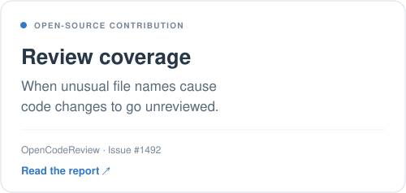
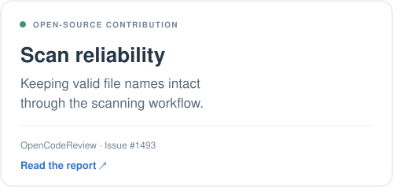
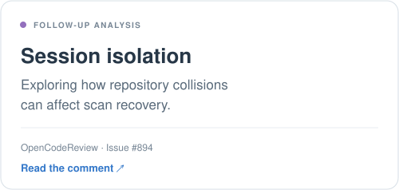
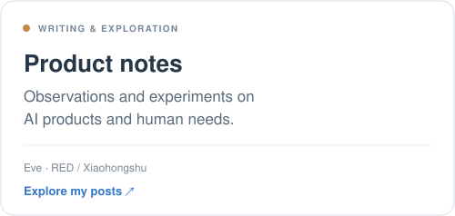

# Hi, I'm Eve 👋

Explore my product thinking, experiments, and open-source contributions below.

I'm an AI Product Manager exploring how AI fits into real workflows.\
I care about what people need, where systems fail, and how we can make them more useful.\
This is where I share what I'm building, testing, and learning.

🧪 [Selected work](#selected-work) · ✍️ [Writing](#writing) · 🌱 [About me](#about-me) · [RED / Xiaohongshu](https://www.xiaohongshu.com/user/profile/634fb9e1000000001802b00f)

---

## Selected work

Projects, product experiments, and contributions to more reliable AI workflows.

### AI product projects

- **[产品工坊 · Product Foundry](https://github.com/EveEveeee/product-foundry)** — an AI product workbench exploration: traceable requirement decisions, linked PRD and technical-plan versions, and an evidence-based review Agent POC. I define the product scope, workflow rules, and acceptance criteria, using Codex and Pi to support implementation. Currently demonstrated through separate local prototypes and POC validation. [Read the project case →](https://wangyangjuan.surge.sh/projects/product-foundry.html)

- **[Muse10 · AI 美甲](https://github.com/EveEveeee/muse10-ai-nails)** — a two-person exploration of nail-style co-creation and in-store try-on. I contribute research, product flows, interaction design, prompts, and quality criteria. Current evidence covers an interactive prototype and local backend POC; personal-hand try-on quality remains under evaluation. [Read the project case →](https://wangyangjuan.surge.sh/projects/muse10-ai-nails.html)

- **[儿童 AI 知识共创 · 豚小蓝](https://github.com/EveEveeee/child-knowledge-cocreation)** — a child-led co-creation project, currently explored through age-adapted story creation. I design the workflow, stage prompts, story context, and quality rules, with local prototypes and recorded model tests. Real family usability and the broader knowledge scope remain to be validated. [Read the project case →](https://wangyangjuan.surge.sh/projects/child-knowledge-cocreation.html)

### Open-source skills

- [Muse10 款式生成](./skills/muse10-nail-visuals/) — my maintained skill for ten-nail catalog visuals, matching wear and detail views, fixed templates, and interactive previews.

- [Evidence-led Product Teardown](./skills/evidence-led-product-teardown/) — a reusable Codex skill for evidence-gated product analysis across the user, technical, model, and data layers, with a traceable HTML deliverable.

  <a href="https://github.com/alibaba/open-code-review/issues/1492"><picture><source media="(prefers-color-scheme: dark)" srcset="./review-coverage-dark.svg"></picture></a>
  <a href="https://github.com/alibaba/open-code-review/issues/1493"><picture><source media="(prefers-color-scheme: dark)" srcset="./scan-reliability-dark.svg"></picture></a>

  <a href="https://github.com/alibaba/open-code-review/issues/894#issuecomment-5748485061"><picture><source media="(prefers-color-scheme: dark)" srcset="./session-isolation-dark.svg"></picture></a>
  <a href="https://www.xiaohongshu.com/user/profile/634fb9e1000000001802b00f"><picture><source media="(prefers-color-scheme: dark)" srcset="./product-notes-dark.svg"></picture></a>

The OpenCodeReview contributions above are issue reports and a follow-up comment, prepared with AI assistance. They are not merged code fixes.

---

## 最新 AI 资讯

每日精选 AI 产品 / 模型 / Agent 动态（自动更新）。

### 2026-10-21

- **[Inception 发布扩散语言模型 Mercury 3：自称 8/12 项测试胜过 GPT-6 Luna 与 Claude Haiku 5.5](https://siliconangle.com/2026/10/20/inception-says-mercury-3-beats-gpt-6-luna-and-claude-haiku-5-5-at-up-to-8x-the-speed/)** — 先整体起草再并行多轮精修，官方实测约 1,068 tokens/s、上下文扩至 1M；SWE-Bench Atlas 得 51.1，定价每百万输入/输出 token 0.2/0.7 美元，可经 OpenRouter、Baseten、Vercel 调用，目前尚无第三方独立评测。 _(SiliconANGLE)_
- **[MiniMax 发布 M3.1 Flash：面向编程与 Computer Use Agent，任务成本降约 70%](https://www.minimax.io/blog/minimax-m31f)** — 官方称在线推理提速近 3 倍、1M 上下文，已上线 MiniMax API、M Plan 与 MiniMax Code，权重稍后开放；Artificial Analysis 给出智能指数 42（较 M3 提升 13 分），但也指出其幻觉倾向偏高。 _(MiniMax / VentureBeat)_
- **[ElevenLabs 推出 Eleven Realtime：一个模型就是一整个语音 Agent](https://elevenlabs.io/blog/realtime)** — 把语音识别、轮次判断、LLM 与 TTS 端到端调成一个 Speech-to-Speech 模型，v1 Mini 主打低成本自然对话，v1 Max 面向客服等多步工具调用场景（Big Bench Audio 98.8%、首音约 0.57 秒）；兼容 OpenAI Realtime API。 _(ElevenLabs)_
- **[Anthropic 上线 OSS Scanner：免费用最强模型为关键开源项目定期扫漏洞](https://www.anthropic.com/research/launching-opt-in-vuln-finding-service-for-open-source)** — 维护者通过向 GitHub 仓库提 PR 自愿加入，每份报告附可复现样例与候选补丁；报告完全由模型生成、不经人工审核，内测中 97 个高危发现有 88% 达到其漏洞披露标准。 _(Anthropic)_
- **[NVIDIA 开源 Flora：给机器人视频自动打标、打分的数据引擎模型](https://research.nvidia.com/labs/gear/flora/)** — 包含 Flora-TempSeg（子任务切分）、Flora-Captioner（带时间戳的动作描述）与 Flora-Rewarder（结果/过程/评分细则奖励）三个模型，是 GR00T 机器人背后的数据引擎，权重已上架 Hugging Face（非商用研究许可）。 _(NVIDIA Research)_
- **[Radical Numerics：首个 AI 设计的噬菌体疗法用于人类患者](https://www.radicalnumerics.ai/blog/omnii-phage)** — 其生物模型 Omnii-1 设计了针对耐药大肠杆菌的 T7 噬菌体变体，经 FDA 授权的单患者同情用药途径给药；实验室中可清除患者菌株，但公司未公开临床结果，仍需更大规模研究验证。 _(Radical Numerics)_

### 2026-10-20

- **[Meta 开源 Muse Glimmer 30B：可在消费级硬件本地运行的端侧 Agent 模型](https://ai.meta.com/research/publications/muse-glimmer-30b-an-on-device-agentic-model/)** — 30B 参数并带视觉感知编码器，把多步推理、工具调用与失败恢复集成进单一模型，量化到约 4-bit 后单 GPU 即可本地推理、无需云端；官方称在工具调用与多步规划等 Agent 评测上领先 Gemma4-31B、Qwen3.6-27B 等同级模型，以 Apache 2.0 许可开源。 _(Meta AI Research)_

### 2026-10-19

- **[Anthropic 拿出 5% 股份设立公益基金，比例可随估值上涨继续追加](https://www.anthropic.com/news/public-benefit-fund)** — 新设全资 LLC「Anthropic Public Benefit Fund」，经股东批准后先注入 5% 股份，估值每较基准上涨 50%，董事会可再追加 2%；连同创始人与员工的捐赠承诺，约 20% 股份将用于公共利益，AI 对就业的影响是重点方向之一。 _(Anthropic)_
- **[Disney 同意接收 Character.AI 大部分员工，后者已申请破产保护](https://techcrunch.com/2026/10/18/disney-agrees-to-hire-the-majority-of-character-ais-workforce/)** — 破产法庭文件显示，Disney 将向至少 60 名员工（含 CEO）发出 offer，预计年薪酬总额约 6000 万美元；该报价属于「假马竞标」，其他买家仍可出更高价，且需破产法官批准。 _(TechCrunch)_
- **[Replit 改以 OpenAI 作为 Replit Agent 的默认模型合作方](https://techcrunch.com/2026/10/17/replit-is-no-longer-working-with-anthropic-ceo-says/)** — CEO Amjad Masad 称这是基于成本、合作关系与性能的决定，随后澄清 Replit 仍保持模型中立，用户依旧可以在模型选择器里选用 Claude。 _(TechCrunch)_
- **[网站开始集体拒绝 AI Agent：Amazon、Delta、摩根大通等相继设限](https://www.theverge.com/ai-artificial-intelligence/1013195/ai-agents-blocked-web)** — Meta Muse、Grok、OpenAI Dots 等 Agent 的用户反映在多家主流网站受阻：Yelp 只放行付费数据授权的 Agent，Delta 阻止 Agent 代订机票，摩根大通与嘉信理财出于安全考虑禁止 Agent 访问账户。 _(The Verge)_
- **[NVIDIA RTX Spark 笔记本正式开售：128GB 统一内存把本地 AI 装进轻薄本](https://blogs.nvidia.com/blog/local-ai-rtx-spark-windows-laptops-celebration/)** — Blackwell RTX GPU 与 Grace CPU 合封为一颗超级芯片，最高 1 PFLOP AI 算力、128GB 统一内存；ASUS、Dell、HP、Lenovo、Microsoft、MSI 首批出货，起售价 2,399 美元。 _(NVIDIA)_
- **[Odyssey 把果蝇大脑模拟放进 Odyssey-3 世界模型，在生成的场景中自主飞行](https://digg.com/science/cvnxmfz7)** — Odyssey 于 10 月 17 日发布演示视频，称基于果蝇连接组的智能体能在实时生成的 3D 世界里自主飞行；但官方尚未公开所用连接组、神经模拟方法与输入输出映射，也没有论文或代码。 _(Digg / Odyssey)_

### 2026-10-18

- **[DeepSeek 升级 V4.1-Flash-1017，并开放自研搜索 Search / Fetch API](https://api-docs.deepseek.com/updates)** — 新版在 DeepSWE v1.1 上达 77.0、Terminal-Bench 4.0 达 42.3，同时缩短任务耗时与输出长度；网页端、App 与 API（deepseek-flash）同步更新，调用方式和价格不变，自研搜索引擎也以 Search / Fetch API 对开发者开放。 _(DeepSeek)_

### 2026-10-17

- **[NVIDIA 发布 Nemotron 3.5 Super VL 与 Bolt：从数据中心到本地的开放 Agent 模型](https://blogs.nvidia.com/blog/nemotron-3-5-super-vl/)** — Super VL 为 120B 总参数、12B 激活的多模态 MoE，支持 1M 上下文、工具调用与文档/视频理解；Bolt 74B-A9B 用原生 2-bit 量化塞进 24GB 内存跑本地 Agent，4GB 的 Bolt E4B 将于 10 月 23 日推出。 _(NVIDIA)_
- **[Reflection 开放 Beam 1.0 权重：501B 开源模型主打编程与长程 Agent](https://reflection.ai/blog/beam-is-available)** — 501B 总参数、23B 激活、1M 上下文，以 Apache 2.0 许可上架 Hugging Face，同步公开模型卡与安全技术报告，并联合 AWS、Ollama、OpenRouter 等 40 多家合作方首发接入。 _(Reflection)_
- **[OpenAI 推出 GPT-Live-1.1：ChatGPT 语音新增多语种音色、口音更自然](https://help.openai.com/en/articles/6825453-chatgpt-release-notes)** — GPT-Live-1.1 与迷你版 GPT-Live-1.1 Quip 进入 ChatGPT Voice，新增法、德、印地、日、韩、墨西哥西语等音色，并减少语音对话中的「检查中」停顿；API 支持即将推出。 _(OpenAI)_

### 2026-10-16

- **[Meta 开源 Muse Spark Open：可在双台 Mac Studio 上本地运行的美系开源权重模型](https://research.meta.ai/blog/muse-spark-open)** — 816B 总参数、42B 激活、1M 上下文的原生多模态模型，面向编程与长程 Agent 任务；可在两台 Apple M5 Ultra Mac Studio 上用 MLX 本地运行，权重与 API 已开放。 _(Meta AI Research)_
- **[Anthropic 向独立评测方 METR 开放接近员工级系统访问](https://www.anthropic.com/news/an-update-on-independent-evaluators)** — 六名 METR 研究员获公司设备、办公位与内部工具，可独立评估风险并自行发布报告；Anthropic 仅可按预定义类别要求脱敏、不能一票否决发布。 _(Anthropic)_
- **[Google Universal Cart 在美国上线：跨零售商统一购物车进 Search 与 Gemini](https://blog.google/products-and-platforms/products/shopping/universal-cart-launch/)** — 可把多家商店商品集中到一个智能购物车，跟踪降价与补货，并支持 Google Pay 结账或回跳商家结账。 _(Google)_ 
- **[Microsoft 完成 MAI-Base-2 预训练：2.8T 参数 MoE 基座模型](https://microsoft.ai/news/frontier-pre-training-at-microsoft-ai/)** — 80B 激活参数，在 1.6 万张 GB200 上训练约 38 天；官方称相对 DeepSeek-V4-Pro-Base 预训练算力效率约高 4–12 倍，现进入后训练阶段。 _(Microsoft AI)_
- **[Anchor 发布 Action Index：把成功网页工作流固化为可回放代码，降低 Computer-Use Agent 成本](https://www.globenewswire.com/news-release/2026/10/15/3382035/0/en/anchor-launches-action-index-cutting-computer-use-agent-token-costs-by-100x.html)** — 共享执行记忆让 Agent 回放已验证路径；在 Online-Mind2Web 300 题上，小模型配合 Index 成功率约 93.3%、单题约 $0.016，接近前沿模型表现但成本大幅下降。 _(GlobeNewswire / Anchor)_
- **[Snyk 推出 Evo Agentic AppSec：用安全 Agent 团队发现、修复并拦截漏洞](https://snyk.io/news/snyk-launches-evo-agentic-appsec/)** — 多类专用安全 Agent 调用确定性扫描引擎，面向 Agent 生成代码与存量代码；其中 Remediation Agent 在可合并修复率评测中约达 90%。 _(Snyk)_

### 2026-10-15

- **[Google 公开发布 Deep Review：面向技术文档的智能体审阅系统](https://research.google/blog/analyzing-technical-documents-with-deep-review/)** — 由论文助手 PAT 演进而来，已在 STOC、ICML、NeurIPS、ICLR 为 1.6 万余篇投稿提供预审反馈，现扩展到 Google Docs、演示文稿及法律、金融等领域文档的有据核查。 _(Google Research)_
- **[Liquid AI 开源 LFM2.5-24B-A2B：面向端侧 Agent 的推理模型](https://www.liquid.ai/blog/lfm2-5-24b-a2b)** — 24B 总参数、每 token 仅激活约 2B，支持 131K 上下文与工具调用，在 Apple M5 Max 上解码约 184 tokens/s，权重已上架 Hugging Face。 _(Liquid AI)_
- **[Fragment 完成 1200 万美元 A 轮，为 AI Agent 提供安全的财务基础设施](https://fortune.com/2026/10/14/fragment-raises-12-million-to-help-keep-ai-agents-from-going-rogue-with-company-money/)** — FirstMark 与 BoxGroup 联合领投，产品用复式记账在资金流动前校验账目平衡，客户包括 Ramp、BILL 与 Whop。 _(Fortune)_

---

## Writing

I share observations on AI products, agents, and human–AI collaboration. I'm interested in the decisions behind a product: who it helps, what it gets wrong, and what makes it worth using.

- [Read my posts on RED / Xiaohongshu →](https://www.xiaohongshu.com/user/profile/634fb9e1000000001802b00f)
- I also write on WeChat about AI products and practical experiments.

---

## About me

- AI Product Manager with an interest in agents, AI workflows, and human–AI collaboration.
- Exploring product ideas through prototypes, evaluations, and open-source participation.
- Learning to turn observations into clear questions, testable assumptions, and better product decisions.
- Building a public record of what I try, what I learn, and what I change my mind about.

**Build** something useful · **Test** it in context · **Learn** from evidence · **Improve** with feedback

Think carefully. Build with purpose. Keep learning.
