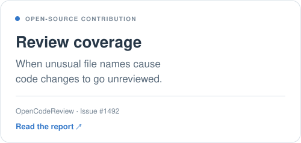
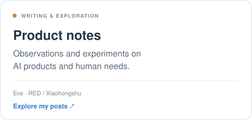

# Hi, I'm Eve 👋

Explore my product thinking, experiments, and open-source contributions below.

I'm an AI Product Manager exploring how AI fits into real workflows.\
I care about what people need, where systems fail, and how we can make them more useful.\
This is where I share what I'm building, testing, and learning.

🧪 [Selected work](#selected-work) · ✍️ [Writing](#writing) · 🌱 [About me](#about-me) · [RED / Xiaohongshu](https://www.xiaohongshu.com/user/profile/634fb9e1000000001802b00f)

---

## Selected work

Projects, product experiments, and contributions to more reliable AI workflows.

### AI product projects

- **[产品工坊 · Product Foundry](https://github.com/EveEveeee/product-foundry)** — an AI product workbench exploration: traceable requirement decisions, linked PRD and technical-plan versions, and an evidence-based review Agent POC. I define the product scope, workflow rules, and acceptance criteria, using Codex and Pi to support implementation. Currently demonstrated through separate local prototypes and POC validation. [Read the project case →](https://wangyangjuan.surge.sh/projects/product-foundry.html)

- **[Muse10 · AI 美甲](https://github.com/EveEveeee/muse10-ai-nails)** — a two-person exploration of nail-style co-creation and in-store try-on. I contribute research, product flows, interaction design, prompts, and quality criteria. Current evidence covers an interactive prototype and local backend POC; personal-hand try-on quality remains under evaluation. [Read the project case →](https://wangyangjuan.surge.sh/projects/muse10-ai-nails.html)

- **[儿童 AI 知识共创 · 豚小蓝](https://github.com/EveEveeee/child-knowledge-cocreation)** — a child-led co-creation project, currently explored through age-adapted story creation. I design the workflow, stage prompts, story context, and quality rules, with local prototypes and recorded model tests. Real family usability and the broader knowledge scope remain to be validated. [Read the project case →](https://wangyangjuan.surge.sh/projects/child-knowledge-cocreation.html)

### Open-source skills

- [Muse10 款式生成](./skills/muse10-nail-visuals/) — my maintained skill for ten-nail catalog visuals, matching wear and detail views, fixed templates, and interactive previews.

- [Evidence-led Product Teardown](./skills/evidence-led-product-teardown/) — a reusable Codex skill for evidence-gated product analysis across the user, technical, model, and data layers, with a traceable HTML deliverable.

  <a href="https://github.com/alibaba/open-code-review/issues/1492"><picture><source media="(prefers-color-scheme: dark)" srcset="./review-coverage-dark.svg"></picture></a>
  <a href="https://github.com/alibaba/open-code-review/issues/1493"><picture><source media="(prefers-color-scheme: dark)" srcset="./scan-reliability-dark.svg"></picture></a>

  <a href="https://github.com/alibaba/open-code-review/issues/894#issuecomment-5748485061"><picture><source media="(prefers-color-scheme: dark)" srcset="./session-isolation-dark.svg"></picture></a>
  <a href="https://www.xiaohongshu.com/user/profile/634fb9e1000000001802b00f"><picture><source media="(prefers-color-scheme: dark)" srcset="./product-notes-dark.svg"></picture></a>

The OpenCodeReview contributions above are issue reports and a follow-up comment, prepared with AI assistance. They are not merged code fixes.

---

## 最新 AI 资讯

每日精选 AI 产品 / 模型 / Agent 动态（自动更新）。

### 2026-11-17

- **[阿里巴巴发布旗舰模型 Qwen4-Max：原生视觉、百万 token 上下文](https://www.alibabacloud.com/en/press-room/alibaba-unveils-qwen4-max)** — 11 月 16 日宣布推出迄今最强的通义千问模型 Qwen4-Max，总参数 2.4 万亿、具备原生视觉能力与 100 万 token 上下文，编码、Agent 与视觉推理表现突出，在 Code Arena 排名第 6；新架构为稀疏 MoE，每 token 仅激活 710 亿参数。公司称在自有 Work360 评测上整体优于前代 Qwen3.8-Max，高推理模式下 token 用量减少 35%、单任务平均成本约降 60%。现已在 QwenCloud（Token Plan / API）以及 QwenWork、QwenStudio 上线，并表示将很快开源更小规模的 Qwen4 系列模型。 _(Alibaba Cloud)_
- **[腾讯发布 Hy4 flash：面向日常工作流的高速低成本模型](https://www.tencent.com/tencent-launches-hy4-flash-to-power-high-speed-cost-efficient-ai-deployment-for-everyday-workflows/)** — 11 月 16 日宣布推出 Hy 系列最新成员 Hy4 flash，总参数 2240 亿（含 640 亿 Engram 参数）、仅激活 120 亿，支持多模态输入与最长 100 万 token 上下文；官方定价约每百万输入 $0.070、输出 $0.281、缓存输入 $0.003，解码速度超过每秒 150 token。公司称在内部 WorkIndex 上单任务成本约为 Hy4 Preview 的 1/13、Hy4 的 1/20。现已登陆腾讯云 TokenHub、WorkBuddy、元宝、企业微信、QQ、ima 和 Marvis，即日起至 11 月 30 日可在 WorkBuddy 免费使用，TokenHub 标准价五折。 _(Tencent)_
- **[NVIDIA 推出 Nemotron for Science：用开源模型与数据帮助构建科学 Agent](https://nvidianews.nvidia.com/news/nvidia-introduces-nemotron-for-science-to-accelerate-discoveries-with-agents)** — 11 月 16 日宣布推出 Nemotron for Science，将开源模型 Nemotron 3.5 Super VL、科学评测、新的开源化学数据集 LitmusBench v0.2（近 5 万道化学推理题）以及后训练配方整合在一起，帮助研究者构建面向化学、蛋白质设计等任务的专业 Agent；模型与数据集已在 Hugging Face 上线，并针对 128GB DGX Spark 做了本地运行优化。阿贡国家实验室、于利希超算中心等机构正在将其用于科学发现 Agent。 _(NVIDIA)_
- **[OpenAI 与四家独立评估机构签约，启动嵌入式安全评估试点](https://openai.com/index/our-first-phase-of-embedded-assessments)** — 11 月 16 日宣布与 Apollo Research、METR、Transluce 和 Goodfire 签署协议，开展第一阶段嵌入式评估：独立专家可在较长期内深入访问内部模型与系统（视评估需要可包括检查点、源代码、训练与评测数据、监测系统等），评估训练与内部使用阶段的对齐情况和安全防护效果，以补充其安全论证，并履行白宫超级智能协议中关于独立评估安全控制的承诺。目前为试点合作，尚未发布评估结论。 _(OpenAI)_

### 2026-11-16

- **[OpenAI 推出科学博客，分享用 AI 推进科学发现的成果与方法](https://openai.com/index/our-new-blog-for-science/)** — 11 月 15 日宣布开设 OpenAI science blog，面向科学家与学术研究者，发布研究成果、模型用于科学计算 / 数据分析 / 文献与实验规划等方法实践，以及研究者的一线经验；强调会说明如何核查工作、方法在何处不足之处。 _(OpenAI)_
- **[GPT-6 Astra 协助提出标准模型的格点定义候选方案](https://openai.com/index/step-toward-defining-the-standard-model/)** — 科学博客首篇客座文章中，加州大学圣塔芭芭拉分校物理学家、OpenAI 访问科学家 Nathaniel Craig 介绍：他此前已有思路并于 10 月发表预印本，Astra 帮助把该策略落实为构造并主导了详细证明，给出标准模型的一个非微扰格点定义候选方案。该结果仍是候选，尚非可直接用于实际模拟的方法。 _(OpenAI)_
- **[印度芯片初创公司 Bharat Semi 获得 2400 万美元种子轮，押注 AI 图像传感器](https://techcrunch.com/2026/11/15/indian-chip-startup-bharat-semi-lands-24m-seed-round-as-it-eyes-global-ai-sensor-market/)** — 11 月 15 日报道，这家成立近五年、尚未实现收入的新德里公司完成 2400 万美元全股权种子轮，由 Info Edge Group、South Park Commons 与 Indus Bridge Ventures 领投，用于研发将成像、处理与 AI 能力集成在单芯片上的可编程图像传感器，并称相较传统分芯片方案有望将系统成本降低至少 70%。公司称已获得美国 General Atomics 与印度 Kaynes Semicon 的设计导入，传感器仍在开发中，目标 2027 年进入初始量产。 _(TechCrunch)_
- **[Safeguard 为每个 AI Agent 配备独立工作区：日历、会议、邮箱、消息、钱包与云盘](https://safeguard.sh/resources/press/safeguard-ai-agent-workspaces-calendar-meetings-mail-messaging-wallet-drive)** — 11 月 15 日宣布，Safeguard 平台上的每个 Agent 将拥有绑定其身份的独立日历、会议席位、邮箱、消息、钱包和云盘，并适用同一套策略、审批与审计追踪，避免借用个人账号办事导致权责不清。Agent 可在允许时段内安排日程、以具名参与者加入或主持会议，并在限额与审批规则下收发邮件、消息和付款。 _(Safeguard)_
- **[一项 API 流量统计显示：无审查模型主要用于 Agent，而非聊天角色扮演](https://huggingface.co/blog/OpenUncensored/uncensored-models-are-agent-infrastructure)** — 11 月 14 日，OpenUncensored 根据 2026 年 11 月一周、157 名付费用户向 84 个模型发出的 150,292 次请求（只记录请求方式、不记录内容）分析称：编程 Agent 占文本模型花费的 49%、请求量的 40%，其他 Agent / 自动化占花费 16%，而聊天、角色扮演和创意应用仅占花费 1.5%；典型请求约 86,612 个输入 token、仅返回 229 个输出 token，符合 Agent 循环的特征。 _(OpenUncensored / Hugging Face)_

### 2026-11-15

- **[Google 将 Google Wallet 接入 Gemini：可基于消费记录提供理财洞察](https://blog.google/innovation-and-ai/products/gemini-app/google-wallet-gemini-app/)** — 11 月 13 日宣布向美国所有 Gemini 应用用户推出：可在 Personal Intelligence 中连接 Google Wallet，通过 @Google Wallet 询问消费、订阅与预算等并生成动态图表；还可选经 Plaid 将信用卡和银行账户安全关联到 Wallet，以获得更深层洞察。连接为只读，Gemini 不能划转、管理或投资资金，用户可随时开关。已在网页与 Android / iOS 的 Gemini 应用推送。 _(Google)_
- **[llama.cpp 发布 v1.0.0：本地推理库迎来首个稳定大版本](https://huggingface.co/blog/ggml-org/llama-cpp-v1)** — 11 月 13 日，llama.cpp 与底层张量库 ggml 同步发布 v1.0.0，并开始采用语义化版本：公共 C API 的不兼容变更将提升主版本号。该版本移除了已弃用的公共 API，支持 150 多种模型架构与主流推测解码方法，并可通过 Debian、Homebrew、conda-forge、Docker、Winget 等渠道分发。 _(llama.cpp / Hugging Face)_

### 2026-11-14

- **[OpenAI 推出 ChatGPT Wallet：dots Agent 可代为安全付款](https://openai.com/index/introducing-chatgpt-wallet)** — 11 月 13 日宣布推出 ChatGPT Wallet，与 American Express、Mastercard、Visa 合作；Agent 通过支付网络代币完成付款、不接触真实卡号，每笔需用户核对商品、金额与所用卡片并以 Face ID 或指纹等安全校验批准。先通过 dots 向年满 18 岁、持有合格美国发行卡片的美国 ChatGPT Pro 订阅者开放，并同步发布面向商家的 Commerce Partner Playbook。 _(OpenAI)_
- **[Sierra 发布 Personal Agent Protocol（Poppy）1.0](https://sierra.ai/blog/releasing-poppy)** — 11 月 13 日宣布协议正式到 v1.0，个人 Agent 可通过企业 Agent、网站与 API 与商家交互，主要基于 MCP、OpenAPI、UCP，并以 OAuth 授权由用户控制权限；Shopify 已为平台全部商家启用，Meta 的 Muse 会在访问站点时优先查找 Poppy，Mercury、Synchrony、Turkish Airlines 等设计伙伴已上线，另有 60 家新伙伴加入，总数超过 100 家。 _(Sierra)_
- **[Yandex 推出 Alice AI「Do it!」：可打电话并完成日常任务](https://yandex.com/company/news/2026-11-13)** — 11 月 13 日宣布 Do it! 可将请求拆成步骤并选用工具，能代为打电话（聊天中显示实时转写）、在云端 Yandex Browser 中浏览网页并填表，并通过插件连接外卖、订花、出行、智能家居等服务；重要操作需用户批准。先向部分开通 Alice Plus 的活跃聊天用户开放，再推向全体订阅者。 _(Yandex)_
- **[Google 向外部开放 Antigravity /teamwork 多 Agent 工作流](https://research.google/blog/advancing-science-engineering-with-antigravitys-teamwork-feature/)** — 11 月 13 日公布 /teamwork 在数学、化学、系统软件与机器学习工程上的最新协作结果，并将 /teamwork、/boost 与 Deep Review 等工具向外部研究者和开发者开放；同时开放申请，为 1 万名学术研究者提供六个月最高用量档免费使用权。 _(Google Research)_
- **[Anthropic 推出 Claude Meetings：可加入视频会议并实时协作](https://claude.com/resources/articles/claude-meetings)** — 11 月 12 日宣布 beta 开始向 Team 与 Enterprise 计划推送：Claude 作为可见参与者加入通话，默认可书面回答问题并在许可下使用已连接工具，还能在会议中协作编写文档、白板等产物并整理笔记与待办；首发支持 Google Meet，其他会议平台即将跟进。beta 期间会议笔记与转写免费。 _(Anthropic)_
- **[Anthropic 推出自托管 Claude Managed Agents 私有预览](https://claude.com/resources/articles/self-hosted-claude-managed-agents)** — 11 月 12 日宣布私有 beta：企业可在自有云或本地运行完整 Managed Agents 服务（含 harness、沙箱、凭证与会话历史），并自行选择将模型请求发往 Anthropic、Amazon Bedrock、Google 的 Agent Platform、Microsoft Foundry 或自有网关；需通过 Anthropic 客户团队申请开通。 _(Anthropic)_

### 2026-11-13

- **[Google 发布 Gemini 4 Hydrogen：面向日常编码与 Agent 工作流](https://blog.google/innovation-and-ai/models-and-research/gemini-models/introducing-gemini-4-hydrogen/)** — 11 月 12 日宣布推出 Gemini 4 Hydrogen，定位日常编码与智能体工作流的快速执行；默认 high 思考档在 Artificial Analysis 指数上以 51 分超过 Argon 的 50 分（xhigh 可达 54），全 100 万 token 上下文统一计价为每百万输入 $1.50 / 输出 $7.50；并在 Google Antigravity 推出 Orchestrator，可在同一会话中动态切换 Carbon 与 Hydrogen，Terminal-Bench 4.0 上接近 Carbon 成功率，同时平均配额减少 24%、完成速度提升 19%。 _(Google)_

### 2026-11-12

- **[Salesforce 发布 SFR-AutoR&D：自主改进生产级嵌入模型的研发 Agent](https://www.salesforce.com/news/stories/agents-that-improve-ai-models/)** — 11 月 11 日宣布一套可端到端跑研究循环的 Agent：给定目标、系统与算力预算后提出假设、实现方法并对照基线实验，仅在有证据且安全时保留改动；已用于改进 Data Cloud 所用的 SFR-Embedding V3，并在开源 EmbeddingGemma 2 上得到质量与延迟更优的 SFR-Embedding v4。 _(Salesforce)_
- **[Anthropic 推出 Claude Whiteboards、Sheets，并将 Dashboards 升级为 Claude Data](https://claude.com/resources/articles/sheets-whiteboards-data)** — 11 月 10 日宣布：Whiteboards 与 Sheets 以 beta 登陆所有付费计划，团队可与 Claude 在同一块白板或表格里实时协作（表格支持多 tab、公式、格式与下拉）；原 Claude Dashboards 正式更名为 Claude Data 并对付费用户全面可用，新增认证查询与实时分享（均为 beta）。 _(Anthropic)_

### 2026-11-11

- **[OpenAI 推出 Businesses in ChatGPT：企业可认领资料并上线 Business Agent](https://openai.com/index/introducing-businesses-chatgpt)** — 11 月 10 日宣布 beta：企业可通过 Business Hub 认领并更新资料、上传含价格与库存的商品信息，查看提及量、网站点击等聚合洞察；合格的美国电商与在线服务商还可上线 Business Agent，与用户在独立、明确标注的对话中交流，并可作为 ChatGPT Ads 落地页。 _(OpenAI)_
- **[Google 正式开放 Gemini 4 Carbon：面向长程 Agent 与高难度技术工作](https://blog.google/innovation-and-ai/models-and-research/gemini-models/gemini-4-carbon-now-available/)** — 11 月 10 日向开发者、企业与消费者开放：强调网络安全与长程 agent 工作流；导入价与 Gemini 4 Argon 相同（每百万输入 $2 / 输出 $10），亦在 Antigravity 预览 `/swarm` 多 Agent 协作，并向 Google AI Ultra 用户在 Antigravity、Gemini App 与 Search AI Mode 等渠道推送。 _(Google)_

---

## Writing

I share observations on AI products, agents, and human–AI collaboration. I'm interested in the decisions behind a product: who it helps, what it gets wrong, and what makes it worth using.

- [Read my posts on RED / Xiaohongshu →](https://www.xiaohongshu.com/user/profile/634fb9e1000000001802b00f)
- I also write on WeChat about AI products and practical experiments.

---

## About me

- AI Product Manager with an interest in agents, AI workflows, and human–AI collaboration.
- Exploring product ideas through prototypes, evaluations, and open-source participation.
- Learning to turn observations into clear questions, testable assumptions, and better product decisions.
- Building a public record of what I try, what I learn, and what I change my mind about.

**Build** something useful · **Test** it in context · **Learn** from evidence · **Improve** with feedback

Think carefully. Build with purpose. Keep learning.
