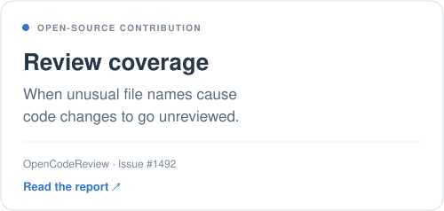
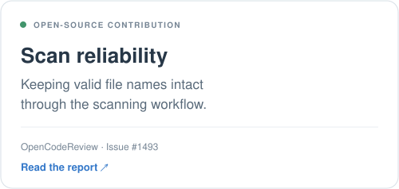
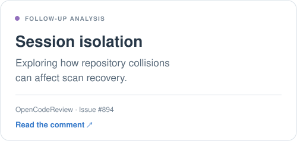
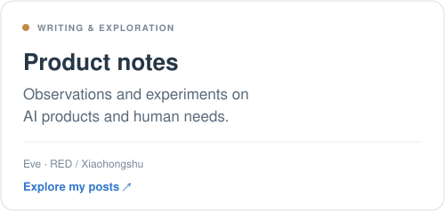

# Hi, I'm Eve 👋

Explore my product thinking, experiments, and open-source contributions below.

I'm an AI Product Manager exploring how AI fits into real workflows.\
I care about what people need, where systems fail, and how we can make them more useful.\
This is where I share what I'm building, testing, and learning.

🧪 [Selected work](#selected-work) · ✍️ [Writing](#writing) · 🌱 [About me](#about-me) · [RED / Xiaohongshu](https://www.xiaohongshu.com/user/profile/634fb9e1000000001802b00f)

---

## Selected work

Projects, product experiments, and contributions to more reliable AI workflows.

### AI product projects

- **[产品工坊 · Product Foundry](https://github.com/EveEveeee/product-foundry)** — an AI product workbench exploration: traceable requirement decisions, linked PRD and technical-plan versions, and an evidence-based review Agent POC. I define the product scope, workflow rules, and acceptance criteria, using Codex and Pi to support implementation. Currently demonstrated through separate local prototypes and POC validation. [Read the project case →](https://wangyangjuan.surge.sh/projects/product-foundry.html)

- **[Muse10 · AI 美甲](https://github.com/EveEveeee/muse10-ai-nails)** — a two-person exploration of nail-style co-creation and in-store try-on. I contribute research, product flows, interaction design, prompts, and quality criteria. Current evidence covers an interactive prototype and local backend POC; personal-hand try-on quality remains under evaluation. [Read the project case →](https://wangyangjuan.surge.sh/projects/muse10-ai-nails.html)

- **[儿童 AI 知识共创 · 豚小蓝](https://github.com/EveEveeee/child-knowledge-cocreation)** — a child-led co-creation project, currently explored through age-adapted story creation. I design the workflow, stage prompts, story context, and quality rules, with local prototypes and recorded model tests. Real family usability and the broader knowledge scope remain to be validated. [Read the project case →](https://wangyangjuan.surge.sh/projects/child-knowledge-cocreation.html)

### Open-source skills

- [Muse10 款式生成](./skills/muse10-nail-visuals/) — my maintained skill for ten-nail catalog visuals, matching wear and detail views, fixed templates, and interactive previews.

- [Evidence-led Product Teardown](./skills/evidence-led-product-teardown/) — a reusable Codex skill for evidence-gated product analysis across the user, technical, model, and data layers, with a traceable HTML deliverable.

  <a href="https://github.com/alibaba/open-code-review/issues/1492"><picture><source media="(prefers-color-scheme: dark)" srcset="./review-coverage-dark.svg"></picture></a>
  <a href="https://github.com/alibaba/open-code-review/issues/1493"><picture><source media="(prefers-color-scheme: dark)" srcset="./scan-reliability-dark.svg"></picture></a>

  <a href="https://github.com/alibaba/open-code-review/issues/894#issuecomment-5748485061"><picture><source media="(prefers-color-scheme: dark)" srcset="./session-isolation-dark.svg"></picture></a>
  <a href="https://www.xiaohongshu.com/user/profile/634fb9e1000000001802b00f"><picture><source media="(prefers-color-scheme: dark)" srcset="./product-notes-dark.svg"></picture></a>

The OpenCodeReview contributions above are issue reports and a follow-up comment, prepared with AI assistance. They are not merged code fixes.

---

## 最新 AI 资讯

每日精选 AI 产品 / 模型 / Agent 动态（自动更新）。

### 2026-11-04

- **[OpenAI 分享物理世界工程加速：Astra 设计整机，硬件团队用量增 23 倍](https://openai.com/index/accelerating-engineering-for-the-physical-world)** — 11 月 3 日发布，展示 GPT‑6 / Astra 在机械、电气与端到端系统设计上的进展：两名成员用 Astra 在约一周内设计出可对话 Codex 的测试设备（外壳、PCB、固件），合同制造商约一月内做出小批量原型；自 2 月起硬件团队 token 用量增长约 23 倍，并扩展与 Chip Ganassi Racing、马自达等合作。 _(OpenAI)_

### 2026-11-03

- **[美团发布 LongCat-2.5：1.6T 原生多模态长程 Agent 模型，全程国产算力](https://longcat.ai/blog/longcat-2.5/)** — 11 月 2 日发布，总参数约 1.6 万亿、约 48B 激活，强化原生视觉理解与智能体编程；官网与 API 同步上线，技术博客称多项基准介于 Claude Opus 4.8 与 Opus 5 之间。 _(美团 / LongCat)_
- **[Anthropic 修订 IPO 招股书：Q3 营收约 170 亿美元，算力承诺约 8954 亿](https://www.cnbc.com/2026/11/02/anthropic-ant-s-1-quarter-financials.html)** — 11 月 2 日向 SEC 提交修订版 S-1，前九个月营收约 332.4 亿美元；Q3 营收约 170 亿、同比增长约 1127%，净亏损约 232.9 亿（多为可转债公允价值变动），并披露约 8954 亿美元算力与基建采购承诺。 _(CNBC)_

### 2026-11-02

- **[DeepSeek 开源 Super-agent 架构原型：Router/Worker 双层、事件驱动与长期在线](https://news.qq.com/rain/a/20261101A00GAD00)** — 智东西 11 月 1 日报道，DeepSeek Harness 团队于 10 月 31 日晚公布并开源 Super-agent 原型（dsh-superagent-prototype），用双层 Router/Worker、事件驱动、异步多信道、存算分离与外部 Watchdog 支撑持续在线与多任务并行；初步实验中位完成时间约 12.4 分钟。 _(智东西 / DeepSeek)_

### 2026-11-01

- **[Gemini API Computer Use 正式 GA，可用于生产级浏览器/移动/桌面自动化](https://ai.google.dev/gemini-api/docs/changelog)** — Google 于 10 月 30 日在 Gemini API 更新日志中宣布 Computer Use 工具在 Interactions 与 GenerateContent API 上全面可用（GA），模型可基于截图返回点击、键盘等 UI 操作，由应用侧执行。 _(Google AI for Developers)_
- **[Google DeepMind 扩大 PlanAssist：再接入 12 个英格兰地方规划局](https://deepmind.google/blog/speeding-up-planning-decisions-with-ai/)** — 10 月 31 日宣布将基于 Gemini 的规划辅助工具推广至额外 12 个地方规划局，进入 12 个月实网 Beta；早期在 Barnet、Camden、Dorset 试点中，官员处理家居类申请评估耗时最高可降约 58%，超 70% 生成报告无需修改即可通过。 _(Google DeepMind)_
- **[OpenAI 最新融资目标据报由约 300 亿美元下调至约 200 亿美元](https://techcrunch.com/2026/10/31/openai-reportedly-lowers-funding-target-for-new-round/)** — TechCrunch 援引《金融时报》等报道称，OpenAI 将本轮募资目标从约 300 亿美元调至约 200 亿美元，投后估值目标约 1.25 万亿美元；阿联酋投资方据报领投，首轮交割额或低于目标。 _(TechCrunch / FT)_
- **[OpenAI 加强青少年防护并承诺发布社区安全报告](https://openai.com/index/community-safety-report-and-new-protections-for-teens/)** — 10 月 30 日宣布将进一步限制向未成年人提供可被滥用的武器相关信息、收紧大规模袭击相关细节，并在出现暴力征兆时更早干预；同时承诺自 2027 年初起每半年发布 Community Safety Report。 _(OpenAI)_
- **[Factory 发布 Droid 1.0：用 Script Mode 一次请求串联数百次工具调用](https://factory.com/news/frontier-harness)** — 官方介绍 Droid 1.0 Agent Harness 默认启用 Programmatic Tool Calling（Script Mode），模型在沙箱中写 JavaScript 批量调用工具；案例中迁移 151 个 Linear issue 时，请求数与输入 token 大幅下降，并称在 Terminal-Bench 4 上相对多家原生 harness 更准更省。 _(Factory)_

### 2026-10-31

- **[OpenAI、Google、Microsoft、Anthropic 支持 robots.txt 统一 AI 训练偏好信号](https://openai.com/index/helping-websites-express-ai-training-preferences)** — 10 月 30 日宣布将采纳 IETF AI Preferences 工作组提出的共享 policy token，站点可在 robots.txt 一次表达是否允许用于基础生成式 AI 训练；Anthropic 已落地，OpenAI 称数月内实施，Google 与 Microsoft 计划明年支持，Microsoft 还将区分训练与 AI grounding。 _(OpenAI / The Verge)_
- **[Mistral 开源万亿参数 Large 4（Le Chonk）权重，主打编程与防御性网络安全](https://mistral.ai/news/mistral-large-4-oss/)** — 10 月 29 日发布改进版开源权重（约 1T 总参数 / ~52B 激活、多模态、1M 上下文），官方称在开源模型中领先 Coding Agent 相关榜单，相对 GLM-5.3 平均少用约 47% token；权重上架 Hugging Face，API 定价约每百万输入 0.70 / 输出 2.10 美元。 _(Mistral AI)_
- **[Google Gemini 现可在对话内生成并编辑 Docs / Sheets / 幻灯片与 PDF](https://www.theverge.com/ai-artificial-intelligence/1022519/google-gemini-file-editing-documents-pdfs)** — 10 月 29 日起面向全部 Gemini 用户开放：可在聊天中预览、全屏编辑并高亮提问改文件；PDF 支持网页与移动端，其余格式目前仅网页版。 _(The Verge)_

### 2026-10-28

- **[Google DeepMind 发布 Genie 4：原生多模态实时世界模拟](https://deepmind.google/blog/genie-4-a-new-generation-of-world-simulation/)** — 10 月 27 日发布，可同步生成音乐/环境音与可交互对话，结合 Gemini 维持场景连贯；可用自然语言实时改天气、镜头与人物，已向受信测试者开放研究预览，并将先对 Google AI Ultra 的 Project Genie 与 Gemini API / AI Studio 早期合作方开放。 _(Google DeepMind)_
- **[Cognition 升级 Devin Security：用前沿网络模型端到端找洞与修洞](https://cognition.ai/blog/devin-security)** — 10 月 26 日推出重大升级，深度扫描由 Claude Mythos 等前沿网络安全模型驱动，按与客户共建的威胁模型评估可利用性与影响并在真实 VM 上并行验证修复；同时承诺投入数亿美元 Devin 积分，为企业提供免费扫描与修复额度。 _(Cognition)_

---

## Writing

I share observations on AI products, agents, and human–AI collaboration. I'm interested in the decisions behind a product: who it helps, what it gets wrong, and what makes it worth using.

- [Read my posts on RED / Xiaohongshu →](https://www.xiaohongshu.com/user/profile/634fb9e1000000001802b00f)
- I also write on WeChat about AI products and practical experiments.

---

## About me

- AI Product Manager with an interest in agents, AI workflows, and human–AI collaboration.
- Exploring product ideas through prototypes, evaluations, and open-source participation.
- Learning to turn observations into clear questions, testable assumptions, and better product decisions.
- Building a public record of what I try, what I learn, and what I change my mind about.

**Build** something useful · **Test** it in context · **Learn** from evidence · **Improve** with feedback

Think carefully. Build with purpose. Keep learning.
