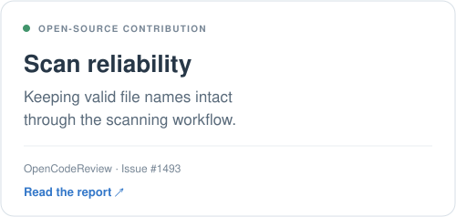
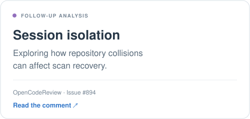

# Hi, I'm Eve 👋

Explore my product thinking, experiments, and open-source contributions below.

I'm an AI Product Manager exploring how AI fits into real workflows.\
I care about what people need, where systems fail, and how we can make them more useful.\
This is where I share what I'm building, testing, and learning.

🧪 [Selected work](#selected-work) · ✍️ [Writing](#writing) · 🌱 [About me](#about-me) · [RED / Xiaohongshu](https://www.xiaohongshu.com/user/profile/634fb9e1000000001802b00f)

---

## Selected work

Projects, product experiments, and contributions to more reliable AI workflows.

### AI product projects

- **[产品工坊 · Product Foundry](https://github.com/EveEveeee/product-foundry)** — an AI product workbench exploration: traceable requirement decisions, linked PRD and technical-plan versions, and an evidence-based review Agent POC. I define the product scope, workflow rules, and acceptance criteria, using Codex and Pi to support implementation. Currently demonstrated through separate local prototypes and POC validation. [Read the project case →](https://wangyangjuan.surge.sh/projects/product-foundry.html)

- **[Muse10 · AI 美甲](https://github.com/EveEveeee/muse10-ai-nails)** — a two-person exploration of nail-style co-creation and in-store try-on. I contribute research, product flows, interaction design, prompts, and quality criteria. Current evidence covers an interactive prototype and local backend POC; personal-hand try-on quality remains under evaluation. [Read the project case →](https://wangyangjuan.surge.sh/projects/muse10-ai-nails.html)

- **[儿童 AI 知识共创 · 豚小蓝](https://github.com/EveEveeee/child-knowledge-cocreation)** — a child-led co-creation project, currently explored through age-adapted story creation. I design the workflow, stage prompts, story context, and quality rules, with local prototypes and recorded model tests. Real family usability and the broader knowledge scope remain to be validated. [Read the project case →](https://wangyangjuan.surge.sh/projects/child-knowledge-cocreation.html)

### Open-source skills

- [Muse10 款式生成](./skills/muse10-nail-visuals/) — my maintained skill for ten-nail catalog visuals, matching wear and detail views, fixed templates, and interactive previews.

- [Evidence-led Product Teardown](./skills/evidence-led-product-teardown/) — a reusable Codex skill for evidence-gated product analysis across the user, technical, model, and data layers, with a traceable HTML deliverable.

  <a href="https://github.com/alibaba/open-code-review/issues/1492"><picture><source media="(prefers-color-scheme: dark)" srcset="./review-coverage-dark.svg"></picture></a>
  <a href="https://github.com/alibaba/open-code-review/issues/1493"><picture><source media="(prefers-color-scheme: dark)" srcset="./scan-reliability-dark.svg"></picture></a>

  <a href="https://github.com/alibaba/open-code-review/issues/894#issuecomment-5748485061"><picture><source media="(prefers-color-scheme: dark)" srcset="./session-isolation-dark.svg"></picture></a>
  <a href="https://www.xiaohongshu.com/user/profile/634fb9e1000000001802b00f"><picture><source media="(prefers-color-scheme: dark)" srcset="./product-notes-dark.svg"></picture></a>

The OpenCodeReview contributions above are issue reports and a follow-up comment, prepared with AI assistance. They are not merged code fixes.

---

## 最新 AI 资讯

每日精选 AI 产品 / 模型 / Agent 动态（自动更新）。

### 2026-11-23

- **[OpenAI 首席科学家提议以困惑度为共同指标，并为前沿模型开发设定行业上限](https://openai.com/index/perplexity-and-intelligence/)** — 11 月 22 日，OpenAI 首席科学家 Jakub Pachocki 发表文章，主张将困惑度（或等价的交叉熵损失）作为比较各实验室预训练进展、并据此制定共享安全标准的共同指标，同时公布了公司内部的困惑度测量：GPT-3.5 约为 0.99、GPT-4 约为 0.91，当前损失已低于 0.8，并在网络安全和数学等领域出现变革性能力。他预计进入约 0.68–0.7 的对数困惑度区间时还会出现新的变革性能力，并提议各前沿模型开发者共同承诺：在对模型行为的理解和监测达到具体里程碑（例如开发出思维链监测的后继方案）之前，不以困惑度等关键指标越过约定上限。 _(OpenAI)_
- **[印度 Sarvam 发布开源权重模型 Sarvam-105B-1711，面向客服、语音与 Agent 任务](https://www.sarvam.ai/blogs/sarvam-105b-1711)** — 11 月 22 日，Sarvam AI 发布 Sarvam 105B 的新开源权重点，基于升级后的 B200 基础设施训练，定位为面向客服、语音 Agent 和工具调用等大规模任务的 Flash-Lite 模型。与 2 月版本相比，八项对话式 Agent 基准的平均分从 42.6 升至 73.9，混合定价由每百万 token 0.44 美元降至 0.15 美元；权重已在 Hugging Face 提供 BF16 以及约 65GB、可在单张工作站 GPU 上运行的 NVFP4 版本。 _(Sarvam AI)_
- **[蚂蚁集团领投中国具身智能公司至简动力 1 亿美元 Pre-A 轮，估值 16 亿美元](https://news.bloomberglaw.com/capital-markets/ant-group-bets-on-simplexity-to-thrive-in-chinas-humanoid-race)** — 11 月 22 日，Bloomberg 报道，杭州具身智能创业公司至简动力（Simplexity Robotics）完成 1 亿美元 Pre-A 轮融资，由马云支持的蚂蚁集团领投，投后估值 16 亿美元；阿里巴巴、腾讯、红杉中国（HongShan Capital）和蓝驰创投等现有投资方跟投。董事长兼联合创始人王凯向 Bloomberg 证实了本轮估值与投资方信息。 _(Bloomberg)_
- **[AWS Quick 支持以插件一次性打包 Agent、技能、连接器与流程](https://aws.amazon.com/about-aws/whats-new/2026/11/aws-quick-plugins-bundle-agents-skills-connectors-flows/)** — 11 月 21 日宣布，AWS Quick 新增插件（plugins），可将面向特定任务、角色或场景的 Agent、技能、连接器和流程打包，用户一次安装即可获得完成该工作所需的能力。用户可浏览并安装 AWS 官方插件（如日程与会议助手、销售开发插件），目前有 100 多项技能和插件覆盖日常效率、财务营销法务等岗位及常用商务应用；也可在对话中描述工作内容，让 Quick 组装自定义插件并分享给团队。该能力已在所有提供 AWS Quick 的区域上线。 _(AWS)_
- **[Google 向印度理工学院卡拉格普尔分校提供 500 万美元，用于 AI 研究与人才培养](https://blog.google/intl/en-in/company-news/supporting-ai-research-and-talent-development-with-iit-kharagpur/)** — 11 月 21 日，Google 印度团队宣布向 IIT Kharagpur 提供 500 万美元资金，支持其推进高级 AI 研究并培养科学与技术人才。资金将用于三个方向：面向印度语言、材料科学、农业和教育科技等实际问题的 AI 研究；面向学生、教师和师资的 AI 培训与课程建设；以及提升校园 AI 框架与工具能力。 _(Google)_
- **[联合国常规武器公约会议未能就自主武器达成具有法律约束力的谈判授权](https://www.theguardian.com/technology/2026/nov/21/international-talks-control-ai-autonomous-weapons-collapse)** — 11 月 21 日，《卫报》报道，在日内瓦举行的联合国《特定常规武器公约》（CCW）会议经过通宵谈判，未能就制定具有法律约束力的自主武器国际条约达成谈判授权。由于该论坛需 128 个缔约方协商一致，会议最终通过较弱授权，要求各国“以协商一致方式拟订”一项可能不具法律义务的文书；报道称俄罗斯以拖延策略带头反对，美国等一些投入 AI 作战的军事大国也不愿承诺有约束力的议定书。 _(The Guardian)_

### 2026-11-22

- **[Lean 与 Mathlib 社区确认 Alpöge 的黎曼猜想 Lean 形式化证明正确](https://leanprover-community.github.io/blog/posts/riemann-hypothesis/)** — 11 月 21 日，Lean 与 Mathlib 社区发表联合声明（获 Lean FRO 与 Mathlib Initiative 背书）：对 Levent Alpöge 于 11 月 20 日发布、约 1700 万行的黎曼猜想 Lean 证明库有充分信心，认定其正确。社区已核验该库可正确编译、所证定理与 Mathlib 中的 RiemannHypothesis 陈述一致，并由 Lean 官方内核及多个独立证明检查器验证导出证明有效。Alpöge 此前表示该证明在 Claude 协助下完成，可读性写作成稿仍待后续。 _(Lean / Mathlib Community)_
- **[OpenAI 公布对抗性蒸馏防护：GPT-6.2 受保护推理提取成功率降至 0.2%](https://openai.com/index/combatting-adversarial-distillation/)** — 11 月 20 日发布，介绍如何检测并阻断未经授权的对抗性蒸馏，并加强对受保护推理（思维链）的防护。在内部自适应红队评估中，从更早一次请求中恢复受保护推理的平均攻击成功率，从 GPT-6 Astra 原有防护下的 54.0%，降至 GPT-6.2 Astra 更新防护后的 0.2%。OpenAI 称新防护将推理与对话前缀绑定，并结合对抗测试、模型训练、分类器与 API 层保护。 _(OpenAI)_
- **[METR 发布 2026 年四季能力更新：前沿模型 50% 时间跨度约 40 小时](https://metr.org/blog/2026-11-20-q4-2026-capability-update/)** — 11 月 20 日公布对公开模型（截至 GPT-6 Astra 与 Opus 5.5）的评测。在合并的 TH1.1 与 TH2 任务集上，50% 时间跨度约每 3.6 个月翻倍；GPT-6 Astra 为 40 小时（95% 置信区间 13–2645 小时），Opus 5.5 为 39 小时（12–1253 小时）。报告同时指出，在缺少清晰经验反馈的判断类任务上，模型仍弱于人类专家，且对是否会在未来数年出现剧烈的 AI 研发加速仍有较大不确定性。 _(METR)_
- **[AWS Quick 推出网页版：浏览器中可创建并调度同一套 Agent 与技能](https://aws.amazon.com/about-aws/whats-new/2026/11/aws-quick-launches-new-web-experience-updated-browser-extension-microsoft-365-add-ins/)** — 11 月 21 日宣布，AWS Quick 网页应用将桌面端体验带到浏览器，可创建、分享并使用与桌面相同的 Agent、技能和连接器；对话、Agent 与文件在网页、桌面和移动端同步，从网页启动或调度的 Agent 在关闭浏览器后仍会继续运行，并可在 Mission Control 查看进度与待确认事项。同时更新了浏览器扩展，以及面向 Word、Excel、PowerPoint 和 Outlook 的 Microsoft 365 加载项。已在美东（弗吉尼亚北部）、美西（俄勒冈）、欧洲（法兰克福、爱尔兰、伦敦）和亚太（悉尼、东京）等区域上线。 _(AWS)_
- **[Amazon Bedrock Web Search 新增五门语言并支持按国家偏向检索](https://aws.amazon.com/about-aws/whats-new/2026/11/web-search-amazon-bedrock/)** — 11 月 21 日宣布，用于为 Agent 和应用提供带引用的即时网页信息的 Web Search，现已在 Amazon Bedrock AgentCore 与 Amazon Bedrock 上新增西班牙语、法语、德语、意大利语和日语，以及非美国英语支持，结果可来自当地语言来源。同时新增可选的国家字段，传入 ISO 3166-1 alpha-2 代码（如 JP、DE）即可偏向特定国家的来源。现有客户自动获得新语言能力、无需改代码，各语言定价相同；查询在调用区域处理。 _(AWS)_

### 2026-11-21

- **[Google 在 Mac 版 Gemini 应用推出 Computer Use，可代为操作桌面应用和网页](https://blog.google/innovation-and-ai/products/gemini-app/computer-use-mac/)** — 11 月 19 日宣布，Mac 版 Gemini 应用新增 Computer Use：用户描述任务后，Gemini 可在独立后台窗口中点击、输入、浏览菜单并填写表单，完成跨本地文件、桌面应用和网页的多步操作，主屏幕与光标不受占用；用户可选择应用权限、观看实时预览，并在关键操作前批准。即日起以英语向美国的 Google AI Plus / Pro / Ultra 个人用户推出，需搭载 Apple Silicon 且运行 macOS Sequoia 15.0 或更高版本。 _(Google)_
- **[Gemini API 预览上线 Tool Retrieval：按需加载工具参数模式](https://blog.google/innovation-and-ai/technology/developers-tools/gemini-api-tool-retrieval/)** — 11 月 19 日宣布，Tool Retrieval 已在 Gemini Interactions API 中以预览形式推出。当 Agent 连接数十甚至上百个工具时，不必在每次请求中发送完整参数 schema，而是将工具库待命、仅在当前任务需要时加载，以降低输入 token 与延迟，并在候选工具增多时保持选择准确率。启用方式为在请求中加入 `tool_search` 工具，并对暂缓加载的工具设置 `defer_loading: true`；模型仍能看到这些工具的名称与描述，需要时由 API 在同一次请求中加载完整 schema 并完成调用。该能力对 Gemini 3.6 及之后的模型（含 Gemini 4 全系列）在 Interactions API 中可用，无单独收费。 _(Google)_
- **[Anthropic 宣布 IPO 与同步私募交割完成，合计募集约 1195 亿美元](https://www.anthropic.com/news/ipo-close)** — 11 月 20 日宣布，Anthropic, PBC 已完成首次公开发行交割：共发行 11.27 亿股 Class A 普通股，定价每股 83.00 美元，含承销商全额行使的 1.47 亿股超额配股权；其中公司出售 1,103,351,354 股，股东出售 23,648,646 股。IPO 总募集资金约 935 亿美元（公司获得约 916 亿美元，未获得股东售股所得）。股票已于 11 月 19 日在纳斯达克全球精选市场以代码 ANT 上市。同期向 AMD、Broadcom、Google、Micron、Microsoft、NVIDIA 和 TSMC Partners 私募出售 313,253,007 股 Class N 普通股，金额约 260 亿美元；IPO（含股东售股）与私募合计总募集资金约 1195 亿美元（扣除承销折扣与发行费用前）。 _(Anthropic)_
- **[OpenAI 发布 MedChemBench：评估模型在药物化学推理中的表现](https://openai.com/index/introducing-medchembench/)** — 11 月 20 日推出包含 99 道题的评测基准 MedChemBench，考察模型能否结合分子结构与实验证据解释结果、比较化合物并预测性质。题目来自 117 篇论文和专利，覆盖 761 种不同分子结构。在 xhigh 推理档位上，GPT-6.2 Astra 获得 84.5% 的可得分数，高于 GPT-6 Astra 的 83.3%、GPT-6.1 Sol 的 82.0% 和 GPT-5.6 Sol 的 58.2%。官方同时指出，该评测基于历史证据而非真实药物发现，不能证明模型能发现新药或改善实验室决策。 _(OpenAI)_
- **[AWS DevOps Agent 扩展聊天能力：支持 MCP 客户端与 Slack、Teams](https://aws.amazon.com/about-aws/whats-new/2026/11/devops-agent-new-chat-capabilities/)** — 11 月 20 日宣布，AWS DevOps Agent 的聊天能力现已扩展到 Kiro、Claude Code 等 MCP 客户端，以及 Slack 和 Microsoft Teams。借助 MCP，Agent 可按指令调用 GitHub、GitLab、Azure DevOps、ServiceNow 和 PagerDuty 等工具，直接在常用聊天界面完成工作流自动化。此次还支持按事故自动创建 Slack 代码频道、在 Teams 中双向聊天，并为 Agent 提供可执行脚本和访问网络的计算沙箱；用户可在所有支持的平台上重命名和归档聊天。 _(AWS)_

### 2026-11-20

- **[Google 通过 Gemini API 向开发者开放世界模型 Genie 4](https://blog.google/innovation-and-ai/technology/developers-tools/genie-4-in-gemini-api/)** — 11 月 19 日宣布，继前一天发布后，Genie 4 现已通过 Gemini API（Interactions API）和 Google AI Studio 向开发者开放。开发者可用文本提示、参考图或两者生成带同步原生音频的连续 720p（24fps）世界，并用实时键盘控制与即时文本提示导航、改变天气、光照、物体或事件；由 Gemini 推理保持世界状态一致。每份输出含不可感知的 SynthID 水印。可在 Google AI Studio 试用交互画布和入门应用。 _(Google)_
- **[OpenAI 公布 Performance Factory：用 Codex Agent 自动排查并修复性能回退](https://openai.com/index/how-openai-performance-factory-keeps-chatgpt-fast/)** — 11 月 19 日介绍基于 Codex 的云端系统 Performance Factory，用于自动发现并修复性能问题。其中 Regression Workflow 在性能告警触发后由 Agent 调查、记录结论并提出修复方案供工程师审核，部署后再由另一个 Agent 核验是否恢复基线；该工作流运行三个多月以来，追踪了超过 1,700 次调查并定位了 600 多起根因，相当于每天约 17 次自动调查。人工复核 100 条根因建议中，70% 被评为准确。 _(OpenAI)_
- **[AWS Marketplace 支持通过 AgentCore 让 Agent 按次付费采购](https://aws.amazon.com/about-aws/whats-new/2026/11/marketplace-agentic-payments-agentcore/)** — 11 月 19 日宣布，AWS Marketplace 现已支持通过 x402 协议进行 agentic payments：AI Agent 可发现并购买部分软件、API、数据和内容，按次以美元支付，费用记入开发者已有的 AWS 账单，无需稳定币钱包，也无需为每个卖家单独申请 API key。用户可预先设置消费限额、批准的卖家和护栏，交易可在 AWS CloudTrail 与 AWS Cost Explorer 中审计。该能力在所有已提供 AgentCore payments 的 AWS 区域可用。 _(AWS)_

### 2026-11-19

- **[Google 发布 Gemini 4 Neon：面向复杂工程、知识工作与科学工作流的快速前沿模型](https://blog.google/innovation-and-ai/models-and-research/gemini-models/introducing-gemini-4-neon/)** — 11 月 18 日宣布推出 Gemini 4 Neon，强调在复杂软件工程、知识工作与科学流程中更快完成端到端任务。在 Artificial Analysis Intelligence Index 的 xhigh 思考档位上总分为 61、整体排名第 3，并在 Vals Index 排名第 2；API 定价为每百万输入 token 3 美元（缓存输入 0.15 美元，折扣 95%）、输出 15 美元，上下文窗口 100 万 token。即日起在 Google AI Studio 的 Gemini API、Gemini for business，以及付费 Google AI Pro / Ultra 用户的 Google Antigravity 与 Gemini 应用中逐步上线。 _(Google)_
- **[Anthropic 公布 IPO 定价：每股 83 美元，股票代码 ANT](https://www.anthropic.com/news/anthropic-prices-initial-public-offering)** — 11 月 18 日宣布，Anthropic, PBC 的 Class A 普通股 IPO 定价为每股 83.00 美元，共发行 9.80 亿股（其中公司出售 956,351,354 股，其余 23,648,646 股由股东出售，公司不获得股东售股所得）。股票预计于 11 月 19 日在纳斯达克全球精选市场上市，代码 ANT，发行预计于 11 月 20 日交割；另给予承销商 30 天内最多加购 1.47 亿股的期权。 _(Anthropic)_
- **[OpenAI 发布 GPT-6.2 Astra 与 Sol：提升专业任务表现并降低成本](https://openai.com/index/introducing-gpt-6-2-astra-sol)** — 11 月 17 日宣布推出面向高难度项目的前沿模型 GPT-6.2 Astra，以及面向日常工作与多步 Agent 流程的高效模型 GPT-6.2 Sol。官方称 Astra 在 Agents’ Last Exam 上比 GPT-6 Astra 高 5.2 分、单任务成本不到三分之一，并比 Claude Fable 5.2 高 5.5 分、成本约为其 5%；API 中 Astra 的输入与输出价格较 GPT-6 Astra 低 20%，为每百万输入 8 美元、缓存输入 0.40 美元、输出 40 美元，Sol 仍沿用 GPT-6.1 Sol 的 API 定价。即日起向 ChatGPT Plus、Pro、Enterprise 和 Edu 用户在 ChatGPT Work 与 Codex 中开放，开发者可通过 API 使用 `gpt-6.2-astra` 与 `gpt-6.2-sol`。 _(OpenAI)_
- **[Microsoft 发布七款新模型：MAI Code 2 等以更低价格覆盖编码与多模态](https://microsoft.ai/news/microsoft-ignite-2026/)** — 11 月 17 日在 Ignite 上宣布推出七款新模型，强调以更低价格支撑可规模化的 Agent 工作。其中 MAI Code 2 在面向 GitHub Copilot 日常企业编码的四项基准上，编码质量约为 GPT-6.1 Sol 的 98%、价格约为其 40%，相对 Claude Opus 5.5 为 96% 性能、约 5% 价格，现已登陆 GitHub Copilot；MAI Code 2 Flash 面向高频日常改代码任务，已在 Copilot 上线，并在 Microsoft Foundry 提供有限预览。同期还有 MAI Image 2.7（Artificial Analysis 图像编辑榜第 1）等模型。 _(Microsoft AI)_

### 2026-11-17

- **[阿里巴巴发布旗舰模型 Qwen4-Max：原生视觉、百万 token 上下文](https://www.alibabacloud.com/en/press-room/alibaba-unveils-qwen4-max)** — 11 月 16 日宣布推出迄今最强的通义千问模型 Qwen4-Max，总参数 2.4 万亿、具备原生视觉能力与 100 万 token 上下文，编码、Agent 与视觉推理表现突出，在 Code Arena 排名第 6；新架构为稀疏 MoE，每 token 仅激活 710 亿参数。公司称在自有 Work360 评测上整体优于前代 Qwen3.8-Max，高推理模式下 token 用量减少 35%、单任务平均成本约降 60%。现已在 QwenCloud（Token Plan / API）以及 QwenWork、QwenStudio 上线，并表示将很快开源更小规模的 Qwen4 系列模型。 _(Alibaba Cloud)_
- **[腾讯发布 Hy4 flash：面向日常工作流的高速低成本模型](https://www.tencent.com/tencent-launches-hy4-flash-to-power-high-speed-cost-efficient-ai-deployment-for-everyday-workflows/)** — 11 月 16 日宣布推出 Hy 系列最新成员 Hy4 flash，总参数 2240 亿（含 640 亿 Engram 参数）、仅激活 120 亿，支持多模态输入与最长 100 万 token 上下文；官方定价约每百万输入 $0.070、输出 $0.281、缓存输入 $0.003，解码速度超过每秒 150 token。公司称在内部 WorkIndex 上单任务成本约为 Hy4 Preview 的 1/13、Hy4 的 1/20。现已登陆腾讯云 TokenHub、WorkBuddy、元宝、企业微信、QQ、ima 和 Marvis，即日起至 11 月 30 日可在 WorkBuddy 免费使用，TokenHub 标准价五折。 _(Tencent)_
- **[NVIDIA 推出 Nemotron for Science：用开源模型与数据帮助构建科学 Agent](https://nvidianews.nvidia.com/news/nvidia-introduces-nemotron-for-science-to-accelerate-discoveries-with-agents)** — 11 月 16 日宣布推出 Nemotron for Science，将开源模型 Nemotron 3.5 Super VL、科学评测、新的开源化学数据集 LitmusBench v0.2（近 5 万道化学推理题）以及后训练配方整合在一起，帮助研究者构建面向化学、蛋白质设计等任务的专业 Agent；模型与数据集已在 Hugging Face 上线，并针对 128GB DGX Spark 做了本地运行优化。阿贡国家实验室、于利希超算中心等机构正在将其用于科学发现 Agent。 _(NVIDIA)_
- **[OpenAI 与四家独立评估机构签约，启动嵌入式安全评估试点](https://openai.com/index/our-first-phase-of-embedded-assessments)** — 11 月 16 日宣布与 Apollo Research、METR、Transluce 和 Goodfire 签署协议，开展第一阶段嵌入式评估：独立专家可在较长期内深入访问内部模型与系统（视评估需要可包括检查点、源代码、训练与评测数据、监测系统等），评估训练与内部使用阶段的对齐情况和安全防护效果，以补充其安全论证，并履行白宫超级智能协议中关于独立评估安全控制的承诺。目前为试点合作，尚未发布评估结论。 _(OpenAI)_

### 2026-11-16

- **[OpenAI 推出科学博客，分享用 AI 推进科学发现的成果与方法](https://openai.com/index/our-new-blog-for-science/)** — 11 月 15 日宣布开设 OpenAI science blog，面向科学家与学术研究者，发布研究成果、模型用于科学计算 / 数据分析 / 文献与实验规划等方法实践，以及研究者的一线经验；强调会说明如何核查工作、方法在何处不足之处。 _(OpenAI)_
- **[GPT-6 Astra 协助提出标准模型的格点定义候选方案](https://openai.com/index/step-toward-defining-the-standard-model/)** — 科学博客首篇客座文章中，加州大学圣塔芭芭拉分校物理学家、OpenAI 访问科学家 Nathaniel Craig 介绍：他此前已有思路并于 10 月发表预印本，Astra 帮助把该策略落实为构造并主导了详细证明，给出标准模型的一个非微扰格点定义候选方案。该结果仍是候选，尚非可直接用于实际模拟的方法。 _(OpenAI)_
- **[印度芯片初创公司 Bharat Semi 获得 2400 万美元种子轮，押注 AI 图像传感器](https://techcrunch.com/2026/11/15/indian-chip-startup-bharat-semi-lands-24m-seed-round-as-it-eyes-global-ai-sensor-market/)** — 11 月 15 日报道，这家成立近五年、尚未实现收入的新德里公司完成 2400 万美元全股权种子轮，由 Info Edge Group、South Park Commons 与 Indus Bridge Ventures 领投，用于研发将成像、处理与 AI 能力集成在单芯片上的可编程图像传感器，并称相较传统分芯片方案有望将系统成本降低至少 70%。公司称已获得美国 General Atomics 与印度 Kaynes Semicon 的设计导入，传感器仍在开发中，目标 2027 年进入初始量产。 _(TechCrunch)_
- **[Safeguard 为每个 AI Agent 配备独立工作区：日历、会议、邮箱、消息、钱包与云盘](https://safeguard.sh/resources/press/safeguard-ai-agent-workspaces-calendar-meetings-mail-messaging-wallet-drive)** — 11 月 15 日宣布，Safeguard 平台上的每个 Agent 将拥有绑定其身份的独立日历、会议席位、邮箱、消息、钱包和云盘，并适用同一套策略、审批与审计追踪，避免借用个人账号办事导致权责不清。Agent 可在允许时段内安排日程、以具名参与者加入或主持会议，并在限额与审批规则下收发邮件、消息和付款。 _(Safeguard)_
- **[一项 API 流量统计显示：无审查模型主要用于 Agent，而非聊天角色扮演](https://huggingface.co/blog/OpenUncensored/uncensored-models-are-agent-infrastructure)** — 11 月 14 日，OpenUncensored 根据 2026 年 11 月一周、157 名付费用户向 84 个模型发出的 150,292 次请求（只记录请求方式、不记录内容）分析称：编程 Agent 占文本模型花费的 49%、请求量的 40%，其他 Agent / 自动化占花费 16%，而聊天、角色扮演和创意应用仅占花费 1.5%；典型请求约 86,612 个输入 token、仅返回 229 个输出 token，符合 Agent 循环的特征。 _(OpenUncensored / Hugging Face)_

---

## Writing

I share observations on AI products, agents, and human–AI collaboration. I'm interested in the decisions behind a product: who it helps, what it gets wrong, and what makes it worth using.

- [Read my posts on RED / Xiaohongshu →](https://www.xiaohongshu.com/user/profile/634fb9e1000000001802b00f)
- I also write on WeChat about AI products and practical experiments.

---

## About me

- AI Product Manager with an interest in agents, AI workflows, and human–AI collaboration.
- Exploring product ideas through prototypes, evaluations, and open-source participation.
- Learning to turn observations into clear questions, testable assumptions, and better product decisions.
- Building a public record of what I try, what I learn, and what I change my mind about.

**Build** something useful · **Test** it in context · **Learn** from evidence · **Improve** with feedback

Think carefully. Build with purpose. Keep learning.
